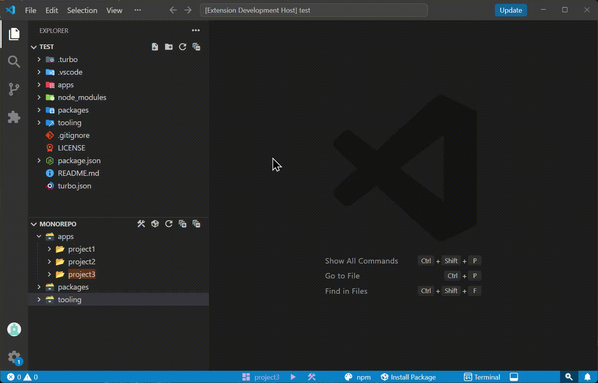
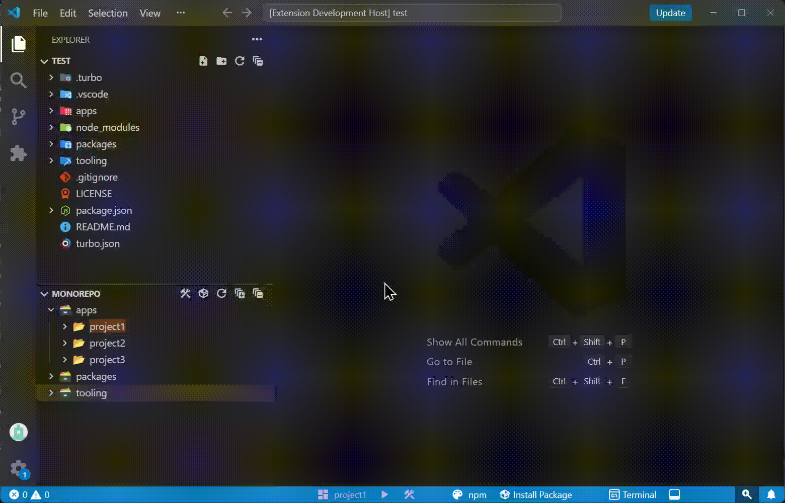
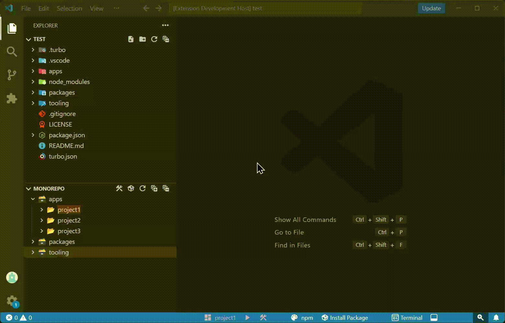
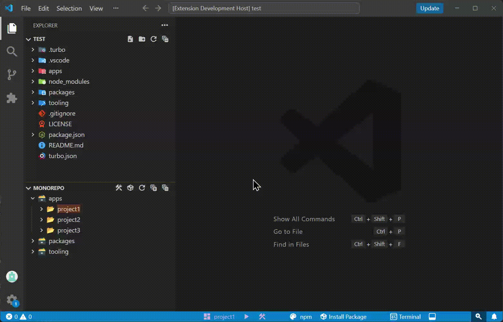
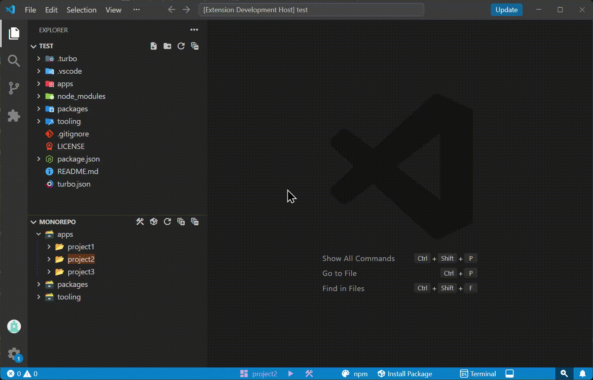
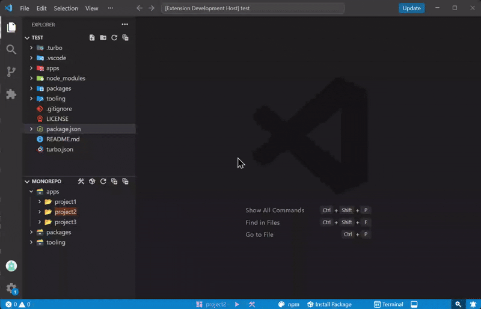
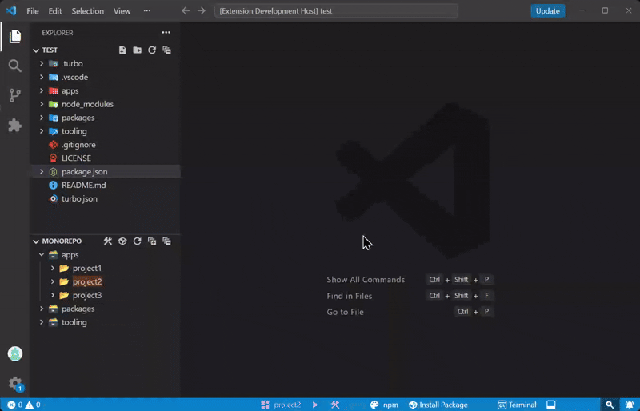
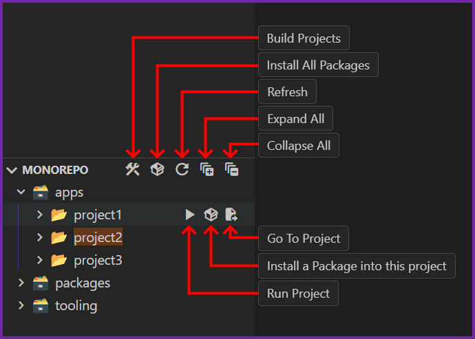
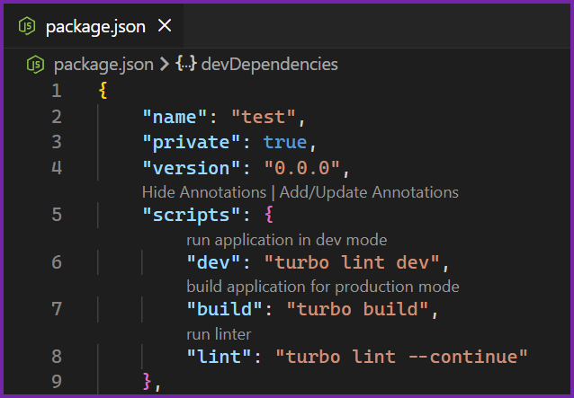
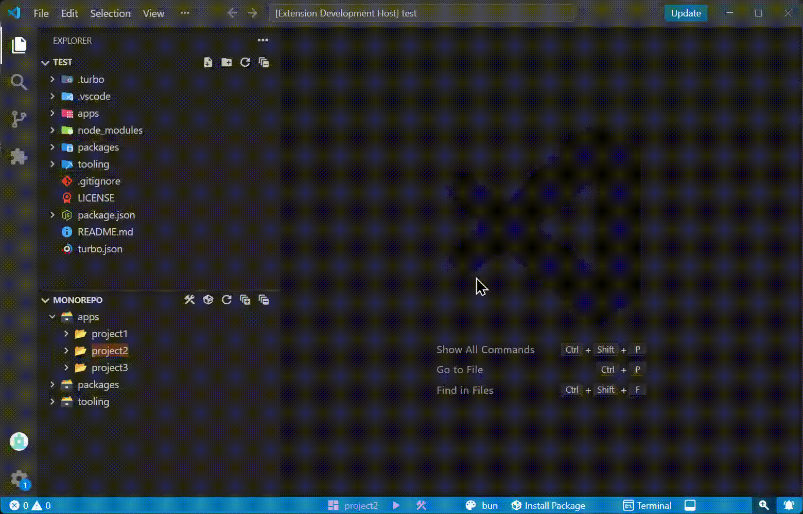

<h1 align="center">
	 
	
	  
	Monorepo Tools
	  
</h1>

Monorepo Tools is a VS Code extension that adds a suite of tools to help manage developing under a monorepo folder structure.

<h2>Table of Contents</h2>

<ul>
	<li>
		<a href="#features">Features</a>
		<ul>
			<li><a href="#project-management">Project Management</a></li>
			<li><a href="#package-management">Package Management</a></li>
			<li><a href="#monorepo-tree">Monorepo Tree</a></li>
			<li><a href="#annotations">Script Annotations</a></li>
			<li><a href="#other-tools">Other Tools</a></li>
		</ul>
	</li>
	<li><a href="#settings">Settings</a></li>
	<li><a href="#changelog">Changelog</a></li>
	<li><a href="#related">Related</a></li>
</ul>

<h2 id="features">Features</h2>

<h3 id="project-management">Project Management</h3>

	<h4 style="margin-bottom: 1rem;">Current Project Selector:</h4>
	

		

		Sets the project in the workspace that is being actively worked on. 
		This project is used as the default when running various commands and when using the <b>Run Project</b> Status Bar button.
		

		
	

	<h4 style="margin-bottom: 1rem;">Building Projects:</h4>
	

		<h4 style="margin-top: 0;margin-bottom: 4px;">There are two ways to build all projects in the workspace:</h4>
		<ol>
			<li>
				The <b>Build All Projects</b> Status Bar button 
				
			</li>
			<li>
				The <b>Build Projects</b> Monorepo Tree button. 
				
			</li>
		</ol>
		

			Both buttons will run the following command: <code><a href="#package-manager-setting">[PACKAGE MANGER]</a> run <a href="#build-script-name-setting">[BUILD SCRIPT]</a></code>
			<blockquote>
				<h4>
					Note: To run this command, the root <i>package.json</i> file needs a script with the same name as the <a href="#build-script-name-setting">BUILD SCRIPT</a> setting.
				</h4>
			</blockquote>
		

	

	<h4 style="margin-bottom: 1rem;">Running Projects:</h4>
	

		<h4 style="margin-top: 0;margin-bottom: 4px;">There are two ways to run a project:</h4>
		<ol>
			<li>
				The <b>Run Project</b> Status Bar button 
				
			</li>
			<li>
				The <b>Run Project</b> Monorepo Tree button. 
				
			</li>
		</ol>
		

			Both buttons will run the following command: <code><a href="#package-manager-setting">[PACKAGE MANGER]</a> run <a href="#run-script-name-setting">[RUN SCRIPT]</a>:[PROJECT]</code>
			<blockquote>
				<h4>
					Note: To run this command, the root <i>package.json</i> file needs a script with the same name as the <a href="#run-script-name-setting">RUN SCRIPT</a> setting.
				</h4>
			</blockquote>
		

	

<h3 id="package-management">Package Management</h3>

	<h4 style="margin-bottom: 1rem;">Package Manager Selector:</h4>
	

		

		Sets the Package Manager to use in the current workspace. 
		This is the package manager used when installing packages or when using the build/run commands.
		

		
	

	<h4 style="margin-bottom: 1rem;">Install Package(s):</h4>
	

		

		This Status Bar button will open a QuickPick to:
		

		<ul style="">
			<li>Install all workspace packages</li>
			
			<li>Select a project and search for an <a href="https://www.npmjs.com/">npm</a> package to install as a dependency or devDependency</li>
			
		</ul>
	

<h3 id="monorepo-tree">Monorepo Tree</h3>

	<h4>Features</h4>
	<ul>
		<li>View internal monorepo dependencies</li>
		<li>Install all project dependencies</li>
		<li>Install dependency into specific project</li>
		<li>Build all projects</li>
		<li>Run specific project</li>
		<li>Shortcut to project's <i>package.json</i> file</li>
		<li>Highlight current active project</li>
	</ul>
	

<h3 id="annotations">Script Annotations</h3>

	<h4>Add user defined annotations to <i>package.json</i> file scripts</h4>
	Annotations are stored in the <a href="#annotations-setting">ANNOTATIONS</a> setting.
	 
	
	 
	<blockquote>
		<h4>
			<b>
				Note: <a href="vscode://settings/editor.codeLens/"><code>Editor Code Lens</code></a> must be enabled in VS Code settings for the annotations to appear.
			</b>
		</h4>
	</blockquote>

<h3 id="other-tools">Other Tools</h3>

	<h4>Button to show the terminal panel:</h4>
	
	<h4>Button to toggle the bottom panel visibility:</h4>
	

<h2 id="settings">Settings</h2>
<table style="margin-left: 1rem;">
	<thead>
		<tr>
			<th>Name</th>
			<th>ID</th>
			<th>Description</th>
			<th>
Type
</th>
			<th>
Default
</th>
		</tr>
	</thead>
	<tbody>
		<tr id="package-manager-setting">
			<td><h4 style="margin: 0;">Package Manager</h4></td>
			<td><code>MonorepoTools.packageManager</code></td>
			<td>The Package Manager to use when running scripts.</td>
			<td>
				
Options

				

				

					<code>npm</code>
					<code>pnpm</code>
					<code>bun</code>
				

			</td>
			<td align="center">
				<code>npm</code>
			</td>
		</tr>
		<tr id="run-script-name-setting">
			<td><h4 style="margin: 0;">Run Script Name</h4></td>
			<td><code>MonorepoTools.runScriptName</code></td>
			<td>The name of the script to use when building applications.</td>
			<td align="center">
				String
			</td>
			<td align="center">
				<code>dev</code>
			</td>
		</tr>
		<tr id="build-script-name-setting">
			<td><h4 style="margin: 0;">Build Script Name</h4></td>
			<td><code>MonorepoTools.buildScriptName</code></td>
			<td>The name of the script to use when running applications locally.</td>
			<td align="center">
				String
			</td>
			<td align="center">
				<code>build</code>
			</td>
		</tr>
		<tr id="annotations-setting">
			<td><h4 style="margin: 0;">Annotations</h4></td>
			<td><code>MonorepoTools.annotations</code></td>
			<td>
				List of script names and their descriptions. 
				Used to display as inline file annotations in the <i>package.json</i> file.
			</td>
			<td align="center">
				List
				

				<table>
					<tr>
						<td style="padding-block: 0; border: none; text-align: end;">Item</td>
						<td style="padding-block: 0; border: none;">name of the script</td>
					</tr>
					<tr>
						<td style="padding-block: 0; border: none;">Value</td>
						<td style="padding-block: 0; border: none;">description of the script</td>
					</tr>
				</table>
			</td>
			<td align="center">
				<table>
					<tr>
						<td style="padding-block: 0; border: none; text-align: end;"><code>dev</code></td>
						<td style="padding-block: 0; border: none;"><i>run application in dev mode</i></td>
					</tr>
					<tr>
						<td style="padding-block: 0; border: none;"><code>build</code></td>
						<td style="padding-block: 0; border: none;"><i>build application for production mode</i></td>
					</tr>
				</table>
			</td>
		</tr>
		<tr>
			<td><h4 style="margin: 0;">Hide Annotations</h4></td>
			<td><code>MonorepoTools.hideAnnotations</code></td>
			<td>Determines if the <i>package.json</i> file annotations should be hidden.</td>
			<td align="center">
				Boolean
			</td>
			<td align="center">
				<code>false</code>
			</td>
		</tr>
	</tbody>
</table>

<h2 id="changelog">Changelog</h2>
See [CHANGELOG](CHANGELOG.md) for more information.

<h2 id="related">Related</h2>
<a href="https://marketplace.visualstudio.com/publishers/ztessema">Other VS Code extensions that I've created</a>